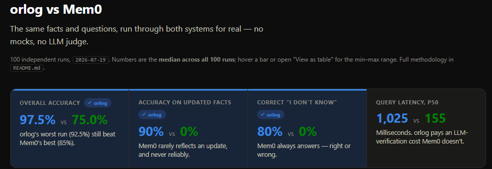

# orlog

[](https://github.com/mrrasmussendk/Orlog/actions/workflows/ci.yml)
[](LICENSE)
[](pyproject.toml)

> Odin feared for Huginn, but worried more for Muninn.
> — *Grímnismál*

**orlog is memory for AI agents that would rather say "I don't know" than be
wrong.** Every claim it hands back is either **VERIFIED** — checked against
the raw historical record, on every single call, no exceptions — or
**ABSTAINED**, with a reason. Nothing in between. No confident-sounding
guesses.

The name is the Norse *ørlǫg*: the immutable layers of what has been laid
down, from which the Norns weave the present. That is the architecture — an
append-only, hash-chained event log, with interpretation continuously
re-woven on top of it, and a deterministic gatekeeper checking every claim
before it reaches the world. Agent knowledge moves through an explicit state
machine instead of an opaque "memory store," so a system built on orlog can
always say *why* it believes something.

> **New here?** [`docs/WHAT-IS-ORLOG.md`](docs/WHAT-IS-ORLOG.md) explains the
> whole idea from scratch, with no jargon and no Norse mythology required.
> Then come back to [Install](#install) and [Your first 60 seconds](#your-first-60-seconds).

## Is orlog for you?

**Use it if** you are building an agent where a wrong remembered fact is
expensive — support, billing, compliance, health, anything with an audit
trail — and you would rather the agent abstain than improvise. You want to
ask *"what did we believe about this on June 1st, and why?"* and get a real
answer with citations.

**Don't use it if** you want a fast, fuzzy semantic scratchpad for chat
context. orlog deliberately spends time verifying every answer (~1s p50 vs.
~155ms for Mem0 — see [the benchmark](#benchmarked-against-mem0)), and it
only stores structured facts, not free-form text blobs.

## Install

Pick whichever line fits how you work:

```bash
pipx install orlog                     # a persistent, isolated install
python -m pip install orlog            # or into the env you already have
brew install mrrasmussendk/tap/orlog   # a prebuilt binary, no Python at all
```

Python 3.11+ for the first two; the Homebrew binary and the
[release zips](#standalone-binary-no-python-required) need nothing.

Just want a look first? `uvx orlog --help` runs it without installing
anything. Don't register an MCP server from `uvx`, though — the command it
would record lives in uv's version-keyed tool cache, so the entry breaks on
`uv cache clean` or the next release. `orlog init --client=` warns you if
the path it is about to register looks like that.

The `anthropic` / `openai` extras (`pipx install 'orlog[anthropic]'`) are
only needed for the real LLM extractor — orlog runs everything
deterministically without them, no API key involved.

Then check your work:

```bash
orlog doctor myproject   # vault key, workspace, embedder, deriver, MCP clients
```

Working on orlog itself rather than with it? See
[Development](#development).

> **Pre-1.0:** the PyPI package is published by
> [`publish-pypi.yml`](.github/workflows/publish-pypi.yml) on each `vX.Y.Z`
> tag ([releasing](docs/RELEASING.md)). If `uvx`/`pipx` can't find a version
> yet, install from a checkout (`pip install .`) or take a
> [release binary](#standalone-binary-no-python-required).

## Your first 60 seconds

Two things to know before the code: orlog stores **structured facts**
shaped `entity` / `attribute` / `value`, and it needs a **vault key** (it
encrypts the PII it tokenizes out of your text).

```python
import os
from orlog.config import OrlogConfig, WorkspaceConfig
from orlog.runtime import Runtime
from orlog.server_tools import remember_tool, recall_tool
from orlog.vault import generate_key
from orlog.workspace import Workspace

os.environ["ORLOG_VAULT_KEY"] = generate_key()   # keep this; you need it to reopen the workspace

runtime = Runtime(
    Workspace("./myproject"),
    OrlogConfig(workspace=WorkspaceConfig(name="myproject")),
)

remember_tool(runtime, "Alice's plan is Pro",
              entity="user:alice", attribute="plan", value="Pro")

recall_tool(runtime, "user:alice.plan")
recall_tool(runtime, "user:alice.shoe_size")
```

The two `recall_tool` calls return, respectively:

```python
{
  "verified": True,
  "claim": "user:alice.plan = Pro",
  "citations": [{"event_id": "01M1SBE...SCE", "excerpt": "Pro",
                 "valid_from": "2026-09-05T17:56:33.922061Z", "valid_to": None,
                 "recorded_at": "2026-09-05T17:56:33.923818Z"}],
  "as_of": "2026-09-05T17:56:33.924467Z",
  "route": "fresh",
  "truth_version": "windows@01M1SBE...SCE",
  "abstained": False,
  "reasons": [],
}

{
  "verified": False,
  "claim": None,
  "citations": [],
  "abstained": True,
  "reasons": ["NO_CANDIDATES"],
}
```

Nothing gets asserted that can't be traced back to a specific, timestamped
event. Ask about something orlog never learned, and it tells you so instead
of inventing an answer.

> `ORLOG_VAULT_KEY` is not stored on disk. Lose it and the encrypted
> pseudonym registry for that workspace is unrecoverable.

## Use it from your agent

orlog speaks MCP, so an agent can call `remember` / `recall` directly. One
command scaffolds the workspace *and* registers the server — including the
vault key, which is the one thing orlog never writes to disk itself:

```bash
orlog init myproject --client=claude-code
```

| `--client=` | writes to |
|---|---|
| `claude-code` | `~/.claude.json` |
| `claude-desktop` | `~/Library/Application Support/Claude/claude_desktop_config.json` (macOS), `%APPDATA%\Claude\…` (Windows), `~/.config/Claude/…` (Linux) |
| `cursor` | `~/.cursor/mcp.json` |
| `vscode` | VS Code's user `mcp.json` |
| `windsurf` | `~/.codeium/windsurf/mcp_config.json` |
| `codex` | `~/.codex/config.toml` (appended, so your comments survive) |

Repeat the flag to register several at once, and `--server-name` to register
a second workspace alongside the first. Every write backs the file up first
and leaves everything else in it alone. Reload the client and the
`remember`, `recall`, `recall_history`, `check_action` and `stats` tools are
there; `orlog doctor` will tell you which clients it found and whether their
entries still point at a real `orlog`.

To do it by hand instead:

```bash
orlog init myproject          # prints a vault key
export ORLOG_VAULT_KEY=...    # from the line above
cd myproject && orlog serve   # MCP stdio server
```

## The five things to know

1. **Facts are `entity.attribute = value`.** `remember` requires all three
   together — a text-only memory is rejected, because it would not be
   retrievable. The free text you pass alongside them is kept as the
   citation excerpt.
2. **Every answer is VERIFIED or ABSTAINED.** There is no third outcome, and
   an abstention always carries machine-readable `reasons`.
3. **There are two independent clocks.** `as_of` is *valid* time — the
   instant you are asking about. `known_as_of` is *transaction* time — the
   instant the answer is allowed to know about, so you can reconstruct what
   the system believed before a correction landed.
4. **Nothing is ever deleted or edited.** A change is a new event that
   supersedes the old one; the old one stays in the log forever. `orlog
   forget` is the one exception, and even it doesn't rewrite history: it
   deletes the encrypted pseudonym mapping so the PII tokens left in the log
   can never be resolved back to a real value (crypto-shredding), and
   records the erasure as another event.
5. **The Norse names are just layers.** `urd` = the log, `verdandi` = the
   current projection, `huginn` = extraction, `heimdall` = the verifier,
   `muninn` = the cache, `skuld` = the outcome ledger. Full map
   [below](#the-norse-module-map).

## Benchmarked against Mem0



There is also a [Phase 0 benchmark](benchmarks/phase0/README.md) (charts:
[`dashboard.html`](benchmarks/phase0/dashboard.html)) measuring what the
§B12 seams cost and save, and what one answer costs an agent in context:
**116 tokens to answer a question, the same at 40 facts and at 10,000**,
against 1.19M tokens to re-read the log for it. Ingest is 14× faster at
2,500 events and the scan tools 94–3265×, with an honest note on the one
call that did not get flat. It needs no API keys.

Same facts, same questions, both systems for real — no mocks, no LLM judge,
100 independent runs. orlog wins accuracy (97.5% vs. 75%) and correct
abstention (80% vs. 0%) decisively, and its worst single run still beat
Mem0's best; Mem0 answers faster per query (155ms vs. 1,025ms p50) because
it skips the citation-verification step orlog never skips. Full
methodology, charts, and the real retrieval bug this benchmark found and
fixed: [`benchmarks/vs_mem0/README.md`](benchmarks/vs_mem0/README.md).

## The state machine

```
OBSERVED ──► INTERPRETED ──► RETRIEVED ──► ASSERTED ──► VERIFIED ──► REINFORCED
(logged)     (projected)     (as-of)       (derived,     (sovereign     (outcome
                                            must cite)     check)         weights)
                                                 │             │
                                                 │             └─ fail ─► RE-DERIVE ─► ABSTAINED
                                                 │                            │
                                                 │                     (retry once,
                                                 │                      then give up)
                                                 └──────────────────────────────────────
                                                    every claim ends VERIFIED or ABSTAINED
```

Every claim a consuming agent can act on is either **VERIFIED** (it passed a
deterministic check, against something outside the memory's own opinion of
itself) or **ABSTAINED** (verification failed twice — once on the original
derivation, once after a single re-derivation attempt — so the system says "I
can't verify this" instead of guessing).

[`docs/DESIGN-PRINCIPLES.md`](docs/DESIGN-PRINCIPLES.md) is the design
rationale (the twelve principles this architecture is built to satisfy).
[`docs/ORLOG-SPEC.md`](docs/ORLOG-SPEC.md) is the normative protocol (v1.0) —
Part A (protocol core) and Part B (the production runtime: MCP server, SQLite
storage, a real LLM `Deriver`, security/PII vault, CLI) are both built and
tested. See "Known deviations" below for the handful of places the code
doesn't match the spec exactly.

## The Norse module map

Thirty-two modules, six layers, one rule: nothing reaches the world
without evidence.

<details>
<summary><strong>Full module-by-module breakdown</strong> (click to expand)</summary>

| Module                | Norse role                              | Layer | What it does |
|------------------------|-----------------------------------------|-------|---------------|
| `urd.py`               | the fixed past — the event log           | L0    | append-only, hash-chained JSONL, ULID ids |
| `storage.py`           | —                                        | L0    | segment rotation (64MB) + the SQLite index, both derivable from the log |
| `verdandi.py`          | what-is-becoming — the projection layer  | L1    | `supersession_chains`: validity windows per fact |
| `verdandi_sessions.py` | —                                        | L1    | `session_summaries`: deterministic per-session digest |
| `retrieval.py`         | —                                        | L2    | point lookup: `retrieve_current_fact` |
| `retrieval_hybrid.py`  | —                                        | L2    | free-text search: lexical + cosine, pluggable `Embedder` |
| `huginn.py`            | thought, sent out for answers — derivation | L3  | `Deriver` protocol, `ScriptedDeriver` (no LLM, deterministic) |
| `huginn_llm.py`        | —                                        | L3    | `LLMDeriver`: real anthropic/openai calls, prompt contract, JSON repair |
| `heimdall.py`          | the watchman at the gate — the verifier  | L4    | checks V1–V4, own ground-truth table (the "windows" backend) |
| `heimdall_pytest.py`   | —                                        | L4    | the "pytest" backend: ground truth = the test suite |
| `verifiers.py`         | —                                        | L4    | the "module:" dynamic-loader extension point |
| `skuld.py`             | what is owed — the outcome ledger        | L5    | records outcomes + importance weighting/decay |
| `muninn.py`            | memory — the route cache Heimdall never trusts on return | cross-cutting | LRU-bounded, gated on re-verification |
| `pipeline.py`          | —                                        | —     | `answer()`: wires cache → verify → retrieve → derive → verify → retry → abstain |
| `states.py`            | the epistemic state machine itself       | —     | legal transitions |
| `vault.py` / `scrub.py`| —                                        | —     | PII tokenization, AES-GCM-encrypted pseudonym registry |
| `config.py`            | —                                        | —     | `orlog.toml` |
| `workspace.py`         | —                                        | —     | directory layout + single-writer lock |
| `queries.py`           | —                                        | L0    | the read-only query surface over `index.sqlite` — every scan the tools do |
| `plugins.py`           | —                                        | —     | entry-point discovery, filtered by the workspace's `[profiles]` |
| `event_types.py`       | —                                        | —     | the `x.<vendor>.*` event-type registry + payload validation |
| `projections.py`       | —                                        | L1    | the projection registry, its cache, and the incremental-append path |
| `tools.py`             | —                                        | —     | the MCP tool registry; binds a profile's `(runtime, ...) -> dict` for FastMCP |
| `runtime.py`           | —                                        | —     | wires a Workspace + Config into a live Pipeline |
| `cli.py`               | —                                        | —     | `orlog init/serve/doctor/conformance/replay/inspect/forget` |
| `mcp_clients.py`       | —                                        | —     | `init --client=<name>`: the per-client MCP config paths and merge strategies |
| `doctor.py`            | —                                        | —     | `orlog doctor`: read-only checks for every way an install silently doesn't work |
| `server.py` / `server_tools.py` | —                               | —     | the MCP server: `remember`/`recall`/`recall_history`/`check_action`/`stats` |
| `observability.py`     | —                                        | —     | structured JSON logs + stats counters |
| `errors.py`            | —                                        | —     | the closed error taxonomy (E_SCHEMA, E_LOCKED, ...) |

The reference domain throughout is point-in-time facts shaped
`{"entity", "attribute", "value"}`. `ScriptedDeriver` is extractive
(deterministic, no LLM call) and ships permanently, per spec, for
API-key-free conformance runs; `LLMDeriver` is the real thing, swapped in via
`orlog.toml`'s `[deriver] backend = "anthropic" | "openai" | "scripted"`.

</details>

## Layout

```
docs/WHAT-IS-ORLOG.md       the no-jargon introduction — start here
docs/RELEASING.md           how a version gets to PyPI, GitHub Releases and Homebrew
docs/DESIGN-PRINCIPLES.md   design rationale
docs/ORLOG-SPEC.md          normative protocol v1.1 — source of truth for src/orlog/
spec/schemas/                JSON Schema contracts for the six layers
src/orlog/models/            pydantic models mirroring the schemas
src/orlog/                   see the module map above
tests/                       one test per contract, plus a unit-test file per module
tests/conformance/           C1 supersession, C2 cache staleness, C3 imperfect projection, C4 citation discipline, C5 immutability & replay
tests/fixtures/orlog_refplugin/  the no-op reference profile: one event type, one projection, one tool
```

## CLI reference

```
orlog init myworkspace          # scaffold a workspace, prints a vault key to export
orlog init myworkspace --client=claude-code   # ...and register it as an MCP server
orlog doctor myworkspace        # what would stop this install working, and why
orlog serve                     # MCP stdio server (one client per server)
orlog serve --http :8787        # ...or one daemon several MCP clients share
orlog replay                    # verify the hash chain, rebuild index.sqlite
orlog inspect <event_id>        # provenance chain
orlog forget <PSEUDONYM_TOKEN>  # crypto-shred
orlog conformance               # run tests/conformance/ against this install
```

`doctor` is read-only — it takes no lock and makes no network call, so it is
safe to run against a workspace a live server is holding, which is when you
are most likely to want it. It exits non-zero only if something is actually
broken.

`--http` binds to `127.0.0.1` unless you spell out a host, and carries no
authentication of its own — it exists so several MCP clients can share one
writer (and one workspace lock) instead of each spawning its own stdio
server and losing the race for it.

Every command except `conformance` takes an optional workspace path
(default: the current directory), given last — `orlog inspect <event_id>
./myworkspace`. The commands that open the vault (`serve`, `forget`) need
`ORLOG_VAULT_KEY` in the environment; `init` is what generates it.

## Standalone binary (no Python required)

Every tagged release (`vX.Y.Z`) publishes standalone `orlog` executables to
[GitHub Releases](https://github.com/mrrasmussendk/Orlog/releases) — no
Python install required — for macOS (arm64 and x86_64), Linux (x86_64 and
arm64) and Windows (x86_64). Download the zip for your platform, unzip it
somewhere on `PATH`, and the same CLI/MCP-server workflow above applies
unchanged:

```
orlog init myworkspace --client=claude-code
```

`brew install mrrasmussendk/tap/orlog` installs the same binary and, because
Homebrew fetches over curl, skips the macOS Gatekeeper prompt a browser
download produces.

The binary bundles both the `anthropic` and `openai` extras. The default
`fastembed` embedder still downloads its model over the network on first
use (see `orlog.toml`'s `[retrieval] embedder`); everything else works
fully offline.

## Development

```bash
git clone https://github.com/mrrasmussendk/Orlog.git
cd Orlog
python -m pip install -e ".[dev,anthropic,openai]"
pytest
```

Tests marked `integration` make real Anthropic API calls and are skipped by
default; run them with `pytest -m integration` and an `ANTHROPIC_API_KEY`
set. Tests marked `perf` build a 100k-event workspace to measure the scan
budget and are skipped too; run them with `pytest -m perf -s`.

### Writing a profile

A *profile* is a distribution that adds event types, projections and MCP
tools to orlog without forking it (`ORLOG-SPEC.md` §B12). Declare entry
points and orlog discovers them:

```toml
[project.entry-points."orlog.event_types"]
mimir = "mimir.event_types:EVENT_TYPES"   # {"x.mimir.decision": DecisionPayload}
[project.entry-points."orlog.projections"]
mimir = "mimir.projections:PROJECTIONS"   # {"decisions_by_topic": DecisionsByTopic}
[project.entry-points."orlog.tools"]
mimir = "mimir.tools:TOOLS"               # {"decisions_about": decisions_about}
```

Then `remember(type="x.mimir.decision", payload={...})` — over MCP, not just
from Python — validates against
your model before anything is appended, `orlog replay` rebuilds your
projection from the log, and your tools are served next to orlog's own.
Core's seven tool names and its own event types are reserved — a profile
cannot replace `recall`. A workspace decides which installed profiles it
loads, in `orlog.toml`:

```toml
[profiles]
enabled = ["mimir"]   # strict allowlist. Omit the key for "every installed
                      # profile"; set it to [] to load none at all. Or use
                      # `disabled` to subtract from the default.
```

`tests/fixtures/orlog_refplugin/` is a working no-op profile exercising all
three groups. `tests/test_plugins.py` installs it as a real distribution
rather than monkeypatching discovery, and
`tests/test_profile_lifecycle.py` drives a profile's whole life — install,
write typed events, restart, `orlog replay`, then turn it off — against a
real `orlog serve --http` daemon in its own process.

## Known deviations from ORLOG-SPEC.md v1.1

- `runtime.py` is 661 lines, `pipeline.py` 521, `cli.py` 571,
  `mcp_clients.py` 519 and `doctor.py` 343 — all over this project's own
  ~200-line-per-file guideline. `pipeline.py` is the central orchestrator
  wiring every layer together plus the optional stats hooks; `runtime.py`
  is the write path plus the registry wiring; `cli.py` is one function per
  subcommand; `mcp_clients.py` is one config-writing strategy per MCP
  client; `doctor.py` is one function per check. The last three are mostly
  the comments explaining *why* each install failure mode is handled the
  way it is, which is the part worth keeping. All five are candidates for a
  cleanup pass.
- `FastEmbedEmbedder` (the spec-default embedder, `BAAI/bge-small-en-v1.5`)
  is now exercised directly by `tests/test_retrieval_hybrid.py`'s
  `resolve_key()` regression tests (three cases, added alongside the
  retrieval-bug fix documented in `benchmarks/vs_mem0/README.md`) — no
  skip marker, and they pass under a plain `pytest` invocation. What's
  still true: no test builds a full `Runtime` with the default embedder
  and uses it live end-to-end. Every test that builds a `Runtime` still
  pins `config.retrieval.embedder = "hashing"` explicitly (or, in
  `test_runtime.py`'s timeout test, monkeypatches the build to hang and
  never actually constructs one) rather than relying on `OrlogConfig`'s
  default, since a cold fastembed build is network-bound.
  `min_confidence`/`ambiguity_margin` for those tests are relaxed back to
  the values calibrated for `HashingEmbedder` (see `RetrievalConfig`'s
  docstring).
- The workspace lock (`workspace.py`) writes its own pid and checks
  whether a held lock's recorded pid is still alive (`_pid_alive()`,
  cross-platform) before honoring it — a stale lock from a crashed or
  killed process is reclaimed automatically rather than blocking forever.
  It is still not a real OS-level advisory lock (no flock/fcntl) and not a
  distributed primitive — enough to stop a second `orlog serve` on the
  same machine, not across machines.
- `orlog conformance --target self` only supports `self` (shells out to this
  install's own `tests/conformance/`). A remote `--target=<endpoint>` mode
  isn't built: `orlog serve --http` (spec §B12.5) now gives it something to
  point at, but the conformance cells assume direct access to the log and
  the index, not just the MCP surface.
- `[schema] known_types` (entity types) and `[schema] known_event_types`
  (event types) are two separate lists. The Mímir plan called for one
  merged `known_types`; keeping them apart means declaring an entity type
  `person` does not also authorize an event type named `person`, and it
  leaves every existing `orlog.toml` reading the way it did.
- `recall` is still O(workspace) per call. The projection cache (§B12.2)
  removed one of three linear passes, but re-materializing every fact
  `Event` from the index and rebuilding the verifier's ground-truth table
  are both still per-call — 38 of 42 ms at 2,500 events. Numbers and the
  profile: [`benchmarks/phase0/README.md`](benchmarks/phase0/README.md).
  The scan tools (`list_entities`, `list_attributes`, `recall_history`,
  `check_action`) ARE flat; `recall` is not, and it needs to be before the
  Mímir plan's Phase 4 latency target.
- `orlog serve --http` has no authentication, no TLS and no multi-tenancy.
  It is a single-machine daemon so several MCP clients can share one
  writer, not a remote server — `ORLOG-SPEC.md` §C4 still defers that.
